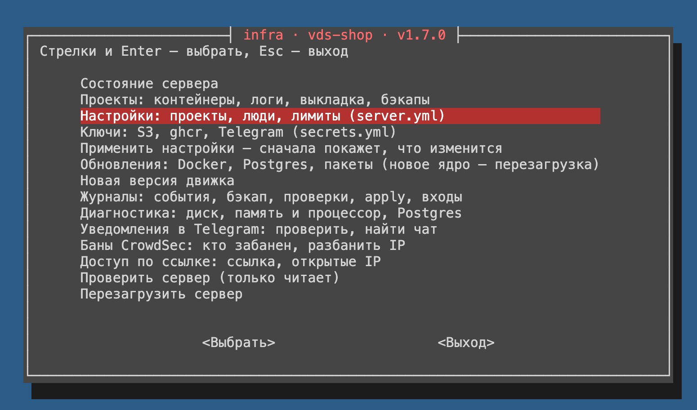

# infra — «панель» VDS на Ansible, без веб-интерфейса

[English](README.en.md)

> **Первый раз ставите сервер? Начните с [`START.md`](START.md)** — пошагово, с нуля: SSH-ключ
> с паролем, ключ у хостера и консоль на крайний случай, вход с меняющегося IP, бэкапы в S3
> с защитой от удаления, Telegram, домен, люди и все настройки одной таблицей.

Движок стоит на самом сервере (`/opt/infra`) и приводит его к одному файлу
`/etc/infra/server.yml`: `sudo infra apply`. На сервере только проекты — сайты в Docker Compose:
у каждого своя сеть, своя база в общем Postgres и свои участники, которые заходят по SSH/SFTP
только в свой проект. SSL, защита, бэкапы и уведомления настраиваются сами. Настройки и пароли
сервера живут на нём, в git — только движок.

**Для кого:** маленькая команда, одна или несколько VDS, на сервере несколько сайтов (Django,
Nuxt, статика — что угодно в контейнерах), разработчики работают с файлами своего проекта,
dev и prod на одной машине. Движок держит рабочие сайты с 2026 года.

**Чем отличается от Coolify, Dokploy, CapRover:** нет веб-панели — нет и открытой наружу точки
с правами root; люди разделены по проектам средствами Linux; результат — обычная конфигурация
Ubuntu: удалили движок — сервер работает дальше. Цена — терминал и YAML вместо кнопок.
Почему так — `DECISIONS.md`.

## Возможности

**Проекты**
- проект — папка с кодом и `compose.yml` и своя Docker-сеть: Django, Nuxt, статика — что угодно
  в контейнерах; проекты друг друга не видят;
- база и пользователь в общем Postgres (PGDG): вход только из сети проекта и через SSH-туннель,
  доступ в `.env` проекта кладёт `project-db-env`, пароль создаёт движок;
- SSL от Let's Encrypt сам: домен — labels в `compose.yml`; заголовки безопасности и лимит запросов
  с одного IP — в Traefik;
- лимиты памяти и CPU на проект (systemd slice), на контейнер — 512 процессов и 65 536 файлов;
- dev и prod рядом: копия прод-базы в `*_dev` одной командой, дамп базы к себе.

**Люди и доступ**
- участники — свои аккаунты Linux, SSH/SFTP только в папки своих проектов, `go <проект>` — сразу туда;
- SSH — только по ключу и с белого списка IP (у каждого человека — свои); убрали человека из
  `server.yml` — ушли его ключи и IP;
- ссылка доступа: с мобильного интернета и в поездке — открыл, нажал кнопку, SSH открыт
  текущему IP на сутки;
- Docker — только у `docker_users`: это root на сервере, и движок этого не скрывает.

**Защита**
- снаружи открыты только 80 и 443, порты контейнеров по умолчанию — на 127.0.0.1;
- root в контейнере — не root на хосте (userns-remap), `no-new-privileges` для всех контейнеров;
- CrowdSec банит атакующих в файрволе по логам SSH и Traefik; ваши IP и IP участников — никогда;
- обновления безопасности Ubuntu ставятся каждую ночь сами.

**Бэкапы (restic)**
- каждую ночь — снимок каждого проекта (папки, тома, дамп базы) и настроек сервера (`/etc`);
- частые снимки нужных проектов — база или всё, раз в 1–60 минут и сразу в S3;
- три уровня: на сервере, у вас на компьютере (`tools/fetch-backups.sh`) и в S3 с Object Lock —
  сервер не может стереть ни одну копию;
- восстановление проекта и перенос на другой сервер — `project-restore`.

**Выкладка**
- автовыкладка: push → CI собирает образ в ghcr.io → сервер за 15 секунд замечает его, выполняет
  миграции, ждёт проверки здоровья, при сбое — возвращает прежнюю версию; откат — одна команда;
- или руками: `git pull` или SFTP и `docker compose up -d`.

**Наблюдение**
- health-check каждые 10 минут: диск, CPU, память, упавшие службы и контейнеры, порты мимо
  файрвола, тома вне бэкапа, сертификаты, выкладки, бэкапы;
- Telegram: только новые и прошедшие проблемы, утром — сводка (нет сводки — сервер лежит);
- журнал событий `/var/log/infra.log` — кто, когда и что: настройки, выкладки, бэкапы, восстановления.

**Управление**
- весь сервер — один `server.yml`: проекты, люди, лимиты; пароли движок создаёт сам;
- `infra edit` проверяет, показывает, что изменится, и спрашивает «Применить?»; прогон
  переживает обрыв SSH;
- меню в терминале `sudo infra` и `infra status` — сервер одним экраном;
- обновления — `infra update` раз в неделю (Docker, Postgres, Traefik, пакеты), новая версия
  движка — `infra upgrade`: только подписанная ключом автора, подменить её на GitHub нельзя;
- свои правки — рядом с файлами движка (`pg_hba.d`, `conf.d`, Traefik `dynamic/`, свои правила ufw):
  их движок не трогает; удалили движок — сервер работает дальше.

## Быстрый старт

Чистая VDS с Ubuntu 26.04 (24.04 — тоже, см. «Ограничения»), вход под root по SSH-ключу:

```bash
ssh root@<IP>
git clone -q https://github.com/mcnickbronx/infra.git /opt/infra
git -C /opt/infra checkout -q v1.7.2          # последняя версия — CHANGELOG.md
/opt/infra/install.sh
infra init     # имя сервера, email для Let's Encrypt, ваши SSH-ключи и IP — и сервер настроится
```

Впервые — по шагам [`START.md`](START.md).

Дальше вход — `ssh admin@<IP>`, root по SSH закрыт. Пароль restic (`restic_password`
из `/etc/infra/secrets.yml`) — сразу в менеджер паролей: без него бэкапы не открыть. Проекты
и люди — `sudo infra edit` (`ADMIN.md`, «Новый проект», «Новый человек»), разработчикам —
`TEAM.md`.

## Меню и команды

Веб-интерфейса нет — есть меню в терминале: `sudo infra`. Каждый пункт — обычная команда движка,
она видна над выводом пункта; то же можно набрать руками.



| Команда | Что делает |
|---|---|
| `sudo infra` | меню (на картинке) |
| `sudo infra status` | сервер одним экраном: проекты, бэкап, уведомления, что не так; только читает |
| `sudo infra edit` | править `server.yml` (проекты, люди, лимиты): проверит, покажет, что изменится, спросит «Применить?» |
| `sudo infra edit secrets` | то же для `secrets.yml`: ключи S3, ghcr, Telegram |
| `sudo infra apply [--check]` | применить настройки; `--check` — только показать изменения |
| `sudo infra update` | обновления: Docker, Postgres, Traefik, пакеты (новое ядро — перезагрузка) |
| `sudo infra upgrade <версия>` | новая версия движка (git-тег, подписанный ключом из `SIGNERS`), затем `apply` |
| `sudo project-compose <проект> ps` | `docker compose` проекта из его папки и с его `.env` |
| `sudo project-deploy <проект> rollback` | вернуть версию до последней автовыкладки |
| `sudo project-backup <проект>` | снимок проекта сейчас; вернуть — `project-restore` (`ADMIN.md`) |
| `sudo project-db-env <проект>` | доступ к базе — в `.env` проекта, пароль на экран не выводится |
| `sudo project-db-copy <проект> <проект>_dev` | заменить базу dev копией прод-базы |
| `sudo infra-access link` | ссылка доступа: SSH с текущего IP на сутки |

Все команды и рецепты — `ADMIN.md`.

## Ограничения

- **Ubuntu 26.04 LTS.** На 24.04 тоже работает — на ней наш тестовый сервер, — но не желательно:
  рабочие серверы и проверки перед версией — на 26.04, поддержка 24.04 кончается раньше. Для 24.04 —
  строка `ubuntu_version: "24.04"` в `server.yml`, иначе `apply` остановится на проверке версии.
  Другие ОС не поддерживаются.
- **Стек фиксирован:** Docker Compose, Traefik, общий Postgres (PGDG), restic, CrowdSec;
  автовыкладка — образы из ghcr.io.
- **На сервере — одна команда:** `docker_users` равны root, люди внутри сервера друг от друга
  не изолированы («Ограничения (осознанные)» ниже). Разные команды — разные серверы.
- **Всё на русском:** документация, сообщения, имена задач.

## Статус и поддержка

Движок делаю для своих серверов и пользуюсь им сам. Как есть: вопросы — в issues, PR принимаю,
но без обещаний по срокам. Лицензия — MIT (`LICENSE`).

## Документация

Дальше в этом файле — как всё устроено, для того, кто будет читать и менять код.

| Документ | Для кого | Что там |
|---|---|---|
| `START.md` | новичок | первый сервер пошагово: ключ, хостер, вход, S3, Telegram, домен, настройки |
| `README.md` | программист | устройство: схема, роли, что где лежит на сервере, как вносить изменения |
| `ADMIN.md` | администратор | что править на сервере и какие команды запускать: сервер, проект, человек, обновления, восстановление |
| `TEAM.md` | команды разработчиков | как работать со своим проектом на сервере: вход, `compose.yml`, база, автовыкладка |
| `DECISIONS.md` | все | почему сделано именно так и что отклонили |
| `CHANGELOG.md` | администраторы | что нового в версии движка и что сделать на сервере при обновлении |

## Модель: всё — проекты

На сервере есть только проекты. Проект — это:

- папка `/srv/projects/<проект>/web` — код и `compose.yml`: Django, Nuxt, статика, что угодно;
- своя Docker-сеть: проекты не видят друг друга;
- при необходимости своя база в общем Postgres сервера;
- участники (`devs`): заходят по SSH/SFTP и работают с файлами своих проектов.

```yaml
# /etc/infra/server.yml (все настройки — server.yml.example)
docker_users: [ivan]          # Docker — это root на этом сервере
projects:
  shop:
    net: 11                   # номер сети 1..254, уникален на сервере, потом не менять
    db: postgres              # база и пользователь shop; без строки — без базы
    devs: [ivan, anna]
  blog:
    net: 12
    devs: [olga]
```

Принципы:

- снаружи открыты только 80 и 443; SSH — с белого списка IP и только по ключу; база —
  только через SSH-туннель;
- **на одном сервере — одна команда.** Docker (`docker_users`) равен root, он только
  у доверенных. Автовыкладка — тоже root (её compose запускается от root), поэтому участники
  проектов с ней — из `docker_users`. И участник без Docker — root, как только его проект
  запускаете вы: `compose.yml` и `.env` в `web/` пишет он, а `project-compose` выполняет их от root. Команды, которые не должны видеть друг друга, — на разных
  серверах: доступ к серверу и есть доступ к его настройкам и паролям;
- root в контейнере — не root на хосте (userns-remap): защита от взломанного контейнера;
- **файл движка помечен «Управляется Ansible»** — его вернёт следующий `apply`; всё остальное
  админ сервера меняет руками свободно, а рядом с файлами движка кладёт свои (`pg_hba.d/`,
  `conf.d/`, `dynamic/` Traefik). Граница целиком — ADMIN.md, «Что можно менять руками».

## Как это работает

```
git: движок (этот репозиторий)     роли, плейбуки, проверки — без серверов и паролей
        │  install.sh / sudo infra upgrade <версия>
        ▼
сервер: /opt/infra                 движок нужной версии и его Ansible (.venv)
        /etc/infra/server.yml      настройки: проекты, люди, лимиты — создаёт sudo infra init, правит админ
        /etc/infra/secrets.yml     пароли: создаёт движок; ключи S3, ghcr, Telegram вписывает админ
        │  sudo infra edit/apply   предпросмотр (--check --diff) → «Применить?» → прогон
        ▼
  1. preflight                       проверки описания: ошибка — остановка до изменений
  2. secrets                         недостающие пароли — создать и дописать в secrets.yml
  3. base → docker → postgres → traefik → crowdsec → users → project → backup → monitoring
        ▼
  интернет → Traefik :80/:443 → контейнеры проекта (сеть proj-<проект>) → Postgres
  сам по себе: бэкап ночью, health-check каждые 10 минут, автовыкладка каждые 15 секунд
```

Ansible работает на самом сервере (`-c local`): команда `infra` подставляет имя сервера
из `server.yml` и запускает прогон службой `infra-apply` — обрыв SSH его не прерывает.
Остальное сервер делает сам — таймерами (таблица ниже). Для людей поверх `apply` — `infra init`
(новый `server.yml` по вопросам), `infra edit` (правка с проверкой YAML и предпросмотром),
`infra status` (сервер одним экраном; только читает) и меню `sudo infra` без параметров
(`infra-menu`, whiptail): пункты меню только вызывают эти и проектные команды (`project-compose`,
`project-deploy`, `project-backup`, `project-db-env`), `infra upgrade`, журналы,
`infra-notify` и `cscli` — своей логики в нём почти нет.

### Роли

Каждая роль — одна тема; `--tags <роль>` раскатывает только её.

| Роль | Что делает | Что ставит на сервер |
|---|---|---|
| `preflight` | проверки описания (`server.yml`, ключи в `secrets.yml`) до любых изменений: ошибка останавливает плейбук с объяснением; сервер не спрашивает | — |
| `secrets` | недостающие пароли (restic, администратор Postgres, база каждого проекта) — создать и дописать в `secrets.yml`; записанные не меняются. Пустые строки ключей администратора (`secrets.yml.example`) — дописать, если их нет | `/etc/infra/secrets.yml` |
| `base` | пакеты, обновления безопасности Ubuntu, SSH только по ключу, файрвол с белым списком IP, журнал событий сервера | `/etc/ssh/sshd_config.d/10-hardening.conf`, `/usr/local/sbin/ufw-sync-whitelist`, `/etc/ufw/ansible-whitelist.json`, `/usr/local/sbin/infra-log`, `/var/log/infra.log` |
| `docker` | Docker с userns-remap и `no-new-privileges`, сеть на проект, общий `base.yml` для compose, очистка образов | `/etc/docker/daemon.json`, `/srv/infra/compose/base.yml`, `docker-cleanup.timer` |
| `postgres` | Postgres из PGDG, база и пользователь на проект, лимиты подключений и времени запроса, журнал медленных запросов | `/etc/postgresql/<версия>/main/`: `conf.d/90-ansible.conf`, `pg_hba.conf` (+ свои строки админа в `pg_hba.d/`) |
| `traefik` | SSL сам, заголовки безопасности, лимиты запросов с одного IP | `/srv/infra/traefik/` |
| `crowdsec` | бан атакующих по логам SSH и Traefik прямо в файрволе, на всех портах; ваши IP и IP участников не банятся | `/etc/crowdsec/acquis.d/traefik.yaml`, `/etc/crowdsec/parsers/s02-enrich/ansible-admin-whitelist.yaml` |
| `users` | аккаунты участников, SSH-ключи, группы, команда `go` | `/home/<человек>`, блок `Match Group devs` в `/etc/ssh/sshd_config` |
| `project` | папки проектов и права, лимиты (systemd slice), `project-compose`, `project-db-env`, автовыкладка | `/srv/projects/<проект>/`, `proj-<проект>.slice`, `project-deploy@<проект>.timer` |
| `access` | ссылка доступа: SSH текущему IP открывшего на сутки; страница без прав, правило ufw — root, по сроку убирает таймер | `/etc/infra-access/config.json`, `infra-access`, `infra-access-web.service`, `infra-access.path`, `infra-access-expire.timer`, `dynamic/infra-access.yml` Traefik |
| `backup` | каждую ночь — снимок каждого проекта (файлы, тома, дамп базы) и копия в S3; проектам с `backup_hourly` — ещё и каждые `backup_every` минут (сразу в S3); копия прод-базы в `*_dev`, дамп базы к себе | `/etc/restic/`, `/var/backups/restic`, `backup.timer`, `backup-hourly.timer`, `project-backup`, `project-restore`, `project-db-copy`, `project-db-dump`, `backup-s3-copy` |
| `monitoring` | каждые 10 минут health-check: диск, CPU, память, упавшие службы и контейнеры, порты мимо файрвола, тома вне бэкапа, сертификаты, неудачная автовыкладка, ночной бэкап и частые снимки, давно не запускали `update.yml`; о новом и прошедшем — в Telegram, утром — сводка | `/usr/local/bin/health-check.sh`, `/usr/local/sbin/infra-notify`, `health-check.timer`, `health-check-summary.timer` |

Скрипты на сервере (`/usr/local/bin`, `/usr/local/sbin`) — из `roles/<роль>/files/` или
`templates/` с тем же именем (у шаблона — плюс `.j2`).

### Что работает на сервере само

| Таймер | Когда | Что делает | Роль |
|---|---|---|---|
| `backup.timer` | ночью, около 03:00 | `backup.sh`: снимок каждого проекта и системы, копия в S3 | backup |
| `infra-access-expire.timer` | каждые 5 минут, если `access_link` | `infra-access expire`: закрыть SSH открытым по ссылке, у кого срок вышел | access |
| `backup-hourly.timer` | с шагом самого частого `backup_every` (60 — в :05 каждого часа), если есть проекты с `backup_hourly` | `backup-hourly.sh`: снимки проектов, чья минута настала, и сразу копия в S3 | backup |
| `health-check.timer` | каждые 10 минут | `health-check.sh --notify`: проверки; в Telegram — что появилось и что прошло | monitoring |
| `health-check-summary.timer` | раз в день, 09:00 (`notify_summary_time`) | `health-check.sh --summary`: сводка в Telegram — нет её, сервер лежит | monitoring |
| `project-deploy@<проект>.timer` | каждые 15 секунд | `project-deploy`: новый образ в реестре → выкладка | project |
| `docker-cleanup.timer` | воскресенье, 02:00 | образы и кеш сборки, не нужные контейнерам и старше 7 дней | docker |
| unattended-upgrades | каждый день | обновления безопасности Ubuntu, без перезагрузки | base |
| `crowdsec-hubupdate.timer` | раз в сутки | правила CrowdSec (таймер самого пакета) | — |

### Из чего состоит проект

Один блок в `projects:` превращается на сервере в:

| Что | Имя | Роль |
|---|---|---|
| группа Linux участников | `<проект>-dev` | users |
| папки | `/srv/projects/<проект>` (root:`<проект>-dev`, 750) и `web/` (2770, ACL для группы и контейнеров) | project |
| Docker-сеть | `proj-<проект>`, 172.20.`<net>`.0/24 | docker |
| лимиты памяти и CPU | systemd slice `proj-<проект>.slice` | project |
| база и пользователь (`db: postgres`) | оба — `<проект>`; строка в `pg_hba.conf`: вход из 172.20.`<net>`.0/24 (и, как всем, с 127.0.0.1 — туннель SSH) | postgres |
| пароль базы | `db_password_<проект>` в `/etc/infra/secrets.yml`; проект кладёт его в свой `.env` | secrets |
| автовыкладка (`autodeploy: true`) | таймер `project-deploy@<проект>` | project |
| бэкап | строка в `/etc/restic/projects.json`, снимки с тегом `project:<проект>` | backup |

### Связи между частями

Части кода связаны именами и файлами. Меняете одну сторону — проверьте другую.

| Связь | Где задаётся | Кто на неё опирается |
|---|---|---|
| сеть проекта: `net: N` → 172.20.N.0/24, адрес Postgres для контейнеров — 172.20.N.1 | роль docker (сеть) | `pg_hba.conf.j2`, ufw в роли postgres, `.env` проекта (руками) |
| имя сервера: `server_name` → имя хоста в прогоне (`inventory_hostname`) | `server.yml`, команда `infra` (`-i <имя>,`) | папка копий в S3 (`s3-env.j2`), сообщения |
| пароли: `secrets.yml` → `secrets` (`group_vars/all/main.yml`) → `db_passwords`, `restic_password`... | роль secrets | роли postgres, backup, project; `tests/verify.yml` |
| имя compose-проекта (`name:` в `compose.yml`) = имя проекта | compose проекта (TEAM.md) | `base.yml` (slice `proj-${COMPOSE_PROJECT_NAME}`), `project-backup` (тома по метке), health-check |
| `/etc/restic/projects.json` — проекты сервера и их базы | роль backup | `backup.sh`, `project-backup`, `project-restore`, `tests/verify.yml` |
| `/var/lib/project-deploy/<проект>.*` — состояние автовыкладки | `project-deploy` | health-check (`*.failed`); роль project убирает `*.failed` проектов без автовыкладки |
| `/var/lib/update-last-run` — отметка «update.yml выполнен» | `update.yml` (создаёт роль monitoring) | health-check |
| `/var/lib/health-check/problems` — о чём уже сообщили в Telegram (проблема без цифр — её ключ) | `health-check.sh --notify` | он же: сообщает только новое и прошедшее |
| журнал событий `/var/log/infra.log` — что, когда и кто: `infra-log "<событие>"` | роль base (скрипт и ротация) | `infra`, `backup.sh`, `project-backup`, `project-restore`, `project-deploy`; бэкап `system`; строки `apply:` и `бэкап:` читают health-check и `infra status` |
| `/var/lib/infra/` — что применено последним полным `apply` (без `--tags`): копия `server.yml`, отпечатки паролей; вывод последнего прогона `last-run.log`; `edit.lock` — один `infra edit` за раз | `infra` | `infra` (diff настроек и пароли в журнал событий; `status` — применён ли `server.yml`) |
| метки «наше»: группа `devs`, комментарии `ansible-wl` в ufw и `ansible-project` у ролей Postgres | роли users, base, postgres | они же: удаляют только помеченное (DECISIONS.md, «Удаляем только своё») |

## Код: где что

```
infra                                 # команда на сервере: init, edit [secrets], status, apply, update, upgrade, run
infra-menu                            # меню (sudo infra без параметров): пункты — те же команды
install.sh                            # установка движка на сервер (как установка панели)
SIGNERS                               # ключи, которыми подписаны версии: infra upgrade ставит только их
server.yml.example                    # все настройки сервера с пояснениями
secrets.yml.example                   # образец secrets.yml: пустые строки ключей, которые вписывает админ
site.yml                              # настройка сервера (запускает infra apply)
update.yml                            # обновления раз в неделю (infra update)
group_vars/all/main.yml               # умолчания движка — по разделам: версии, по умолчанию, внутреннее
group_vars/all/derived.yml            # вычисляемое: участники сервера и их группы, проекты с базой, IP для SSH
roles/<роль>/tasks/main.yml           # что делает роль — читать сверху вниз
roles/<роль>/files/, templates/       # файлы для сервера как есть и шаблоны с переменными
tools/rollout.sh                      # копия движка на тестовый сервер и проверки (make test-vds)
tools/fetch-backups.sh                # копия бэкапов к вам на компьютер
tools/check.sh (make check)           # проверки без серверов, то же в CI
tests/                                # эталоны шаблонов, испорченные описания, проверки на сервере;
                                      # menu.py — нажимает клавиши в меню (сценарий 6)
```

Переменные: умолчания — `group_vars/all/main.yml` (рядом с `site.yml`), вычисляемые —
`derived.yml`, значения сервера — `/etc/infra/server.yml` (важнее умолчаний), пароли —
`secrets.yml`; у ролей нет `defaults/` и `vars/`. Умолчание для ключа проекта `X` —
`project_default_X`.

## Как вносить изменения

Это работа с самим движком; настройки конкретного сервера правятся на нём (ADMIN.md).
Порядок: правка → `make check` → `tools/rollout.sh <тестовый сервер>` (или `make test-vds`) →
коммит, подписанный тег версии и строка в CHANGELOG → на рабочих серверах `sudo infra upgrade <версия>`.

Тег версии подписывается SSH-ключом из `SIGNERS`: без подписи `infra upgrade` версию не поставит,
и тот, кто получил бы доступ к репозиторию на GitHub, не выпустит её за вас. Один раз в клоне:
`git config gpg.format ssh && git config user.signingkey ~/.ssh/id_ed25519.pub`, дальше
`git tag -s vX.Y.Z -m vX.Y.Z` (ключ — из ssh-agent). Проверка — по `SIGNERS` той версии, что уже
стоит на сервере, поэтому новый ключ в `SIGNERS` действует со следующей версии. Свой форк — свой ключ
в `SIGNERS`, и теги подписываете им.

Соглашения в коде:

- **Задача называется состоянием,** которое она создаёт («Папки проектов», «Белый список SSH»);
  комментарий над ней — почему так, а не что она делает. Имена и комментарии — по-русски.
- **Повторный прогон ничего не меняет.** У `command` и `shell` — `changed_when`; удаляется
  только помеченное своим (таблица «Связи между частями»).
- **`--check` не падает.** Команды, которые только читают, — `check_mode: false`; задачи над
  тем, что создаётся в этом же прогоне (группа, папка, база нового проекта), в `--check`
  пропускаются: `when: not ansible_check_mode or ...`.
- **Проверки описания — в `preflight`,** с понятным `fail_msg`; роли считают описание верным.
  Роль проверяет только то, что зависит от сервера (кто подключён, какие аккаунты уже есть).
- Файл для сервера начинается с «Управляется Ansible» (если формат позволяет комментарии):
  открывший его на сервере поймёт, что ручная правка перезапишется. Пароли в задачах —
  `no_log: true`.

Частые изменения:

- **Новая настройка:** значение по умолчанию в `group_vars/all/main.yml` → использование в роли →
  проверка формата в `preflight` и сервер с этой ошибкой в `tests/inventory/host_vars/bad-*.yml`
  (группа `invalid` в `tests/inventory/hosts.yml`, ожидаемое сообщение — `expect_error`) →
  значение в `tests/inventory/host_vars/full.yml` → ключ в `server.yml.example`.
- **Новый пароль:** имя в списке `needed` роли secrets → использование через `secrets.<имя>`
  в `main.yml`; вымышленное значение — в `tests/inventory/group_vars/tested/fake-secrets.yml`.
  Ключ, который вписывает админ, — пустой строкой `<имя>: ""  # зачем` в `secrets.yml.example`
  (на серверах её допишет `apply`) и `secrets.<имя> | default('', true)` в `main.yml`.
- **Новое действие, которое что-то меняет** (скрипт, команда): строка в журнал событий —
  `infra-log "<что>: <итог>"`, и при неудаче тоже (ADMIN.md, «Где смотреть, что происходило»).
- **Новый скрипт на сервере:** файл в `roles/<роль>/files/` (переменные нужны — `templates/`,
  и шаблон — в список `tests/render.yml`), задача `copy` или `template`. Shellcheck находит
  скрипты в `files/` сам, из шаблонов — по имени `*.sh`; что скрипт делает на сервере —
  проверка в `tests/verify.yml` или сценарий в `tests/scenarios.yml`.
- **Новая роль:** `roles/<роль>/tasks/main.yml`, строка с меткой в `site.yml` (порядок
  важен — комментарий там же), строка в таблице «Роли».
- **Точка расширения для админа** (свой файл рядом с файлом движка): движок подключает папку
  или файл, но не пишет в него — как `pg_hba.d/`. Это контракт: менять его — только в новой
  мажорной версии движка с инструкцией в CHANGELOG.
- **Убрать возможность:** код, тесты и документация удаляются, в DECISIONS.md — строка
  в «Убрано ради простоты».

### Проверки

| Слой | Что проверяет | Когда |
|---|---|---|
| `make check` | ansible-lint, shellcheck, синтаксис; все шаблоны на вымышленном сервере, где включено всё (`tests/inventory`), сравниваются с эталоном `tests/golden`; испорченные описания (`tests/invalid.yml`) должны остановиться на своей проверке; Python-тесты. Серверы не нужны, то же в CI | перед каждым коммитом (хук — перед push) |
| `tools/rollout.sh <сервер>` | копия рабочей версии движка на сервер, `infra apply --check`, прогон, повторный прогон без изменений, `tests/verify.yml`: службы, файрвол, SSH, права, аккаунты, вход в базы, health-check | каждая правка движка, на тестовом сервере |
| `make test-vds` | то же плюс сценарии на тестовом сервере (`test_server: true` в его `server.yml`), по-настоящему: бэкап → порча → восстановление, удаление аккаунта с открытой сессией, проект в Docker, автовыкладка с откатом | перед новой версией движка и раз в несколько месяцев, ~30 минут |

- **Эталон изменился** — `git diff tests/golden` показывает ровно то, что изменится в файлах
  на серверах. Так и задумано — `git add tests/golden` и коммит вместе с правкой.
- **Повторный прогон что-то изменил** — задача не идемпотентна, `tools/rollout.sh` её называет.

## Доступ

- SSH/SFTP открыт с `admin_ips` (ваши адреса, на всех серверах) и с `ips` участника
  (на серверах его проектов). Убрали человека — его IP уходят из файрвола сами.
  Человеку с меняющимся IP — подсеть его провайдера в `ips` (`203.0.113.0/24`); с мобильного
  интернета и в поездке — ссылка доступа: открыл, нажал кнопку — SSH открыт текущему IP на сутки
  (`sudo infra-access link`, роль `access`).
- Участник работает в `/srv/projects/<проект>/web` (git, SFTP), к базе подключается через
  SSH-туннель — пробросить можно только `127.0.0.1:5432`; пароль базы ему даёт администратор.
  Чужие проекты и домашние папки ему недоступны.
- `docker_users` запускают контейнеры обычным `docker compose`. **Это root на сервере:**
  все пароли баз, ключи бэкапа. Остальным контейнеры перезапускают они или вы:
  `sudo project-compose <проект> up -d` (это `docker compose` в папке проекта с его `.env`).
  `compose.yml` и `.env` пишет участник, а `project-compose` выполняет их от root: запуская его
  проект, вы доверяете ему как `docker_users`. Чужой код — сначала посмотреть `compose.yml`.
- Плейбук не включит файрвол, если IP, с которого вы подключены, нет в белом списке
  (команда `infra` находит IP вашей SSH-сессии сама, из tmux и screen — всех ваших SSH-сессий;
  не нашла — тоже остановка, с консоли хостера проверки нет). Всё же закрыли себе доступ — консоль
  VDS у хостера (ADMIN.md, «Если что-то сломалось»).

## Обновления

Сами ставятся только обновления безопасности Ubuntu, без перезагрузки. Остальное — Docker
(containerd, runc), Postgres в пределах `postgres_version`, CrowdSec, пакеты, образ Traefik,
перезагрузка после нового ядра — `sudo infra update` раз в неделю, сначала на тестовом сервере.
Не запускали больше недели — health-check напомнит. Крупные версии (Traefik, Docker, Ubuntu)
меняются числом в разделе «Версии» `group_vars/all/main.yml` — с новой версией движка;
порядок — ADMIN.md, «Обновления».

Ubuntu 26.04 — на всех серверах (поддержка до апреля 2031), плейбук проверяет версию.
Что в ней иначе: sudo — sudo-rs, coreutils — uutils. `mkdir` из uutils в папке проекта
ставит на новую папку sticky-бит (удалять файл может только владелец) — папки для данных
приложения создавайте `mkdir` + `chmod 02770` (с нулём впереди: в 26.04 `mkdir` ставит и setuid, а
`chmod 2770` его у папки не снимает). С `--ask-become-pass` нужен ansible-core
не старше мая 2026 (запрос пароля sudo-rs).

## Проекты: лимиты, база, файлы

- **Логи по кругу.** Контейнеры — 10 МБ × 5 файлов (`daemon.json`; свои опции `logging:`
  в compose Docker дополняет этим пределом, а `max-size: "-1"` не принимает — проверено),
  access-лог Traefik — файлы до 200 МБ, 14 штук, журнал событий — до 10 МБ, 24 штуки;
  logrotate — каждый час. Переполнить диск логами может только приложение, которое пишет
  их в файлы внутри контейнера или в том (TEAM.md, «Правила для compose»).
- **Лимиты.** Контейнеры проекта работают в systemd slice `proj-<проект>.slice`
  (`cgroup_parent` в `base.yml`): память и CPU на весь проект, меняются без перезапуска
  (`systemctl status proj-shop.slice`). Сумма лимитов может быть больше памяти сервера —
  это потолки. На контейнер — 512 процессов и 65 536 открытых файлов. Диск не делится:
  логи Docker ограничены, образы чистятся раз в неделю, уведомление при 80 % со списком,
  кто занял место; локальный бэкап при 90 % не пишется.
- **База.** Пользователь = база = имя проекта, владелец базы. Подключение: адрес
  `172.20.<net>.1`, порт 5432, пароль — `db_password_<проект>` в `/etc/infra/secrets.yml`;
  проект держит доступ в своём `.env`. Второй пользователь (аналитика) — руками в Postgres
  и своей строкой в `pg_hba.d/`, движок таких не ведёт. Тесты Django на сервере не идут:
  создавать базы проекту нельзя — тесты в CI или локально.
- **Медленные запросы Postgres.** Дольше секунды, ожидание блокировок, сортировки без памяти —
  в `/var/log/postgresql/postgresql-<версия>-main.log`. Что суммарно дороже всего:
  ```bash
  sudo -u postgres psql -c "SELECT d.datname, s.calls, round(s.total_exec_time) AS total_ms,
    round(s.mean_exec_time, 1) AS mean_ms, left(s.query, 80) AS query
    FROM pg_stat_statements s JOIN pg_database d ON d.oid = s.dbid
    ORDER BY s.total_exec_time DESC LIMIT 20"
  ```
- **Файлы.** `web/` открыт группе проекта и контейнерам (ACL для групп 0, 33, 1000 внутри
  контейнера — `docker_remap_web_gids`). Писать контейнер может только туда, где у группы
  есть запись: папки для загрузок — `mkdir` + `chmod 02770` (автовыкладка — `install -d -m 2770`).
  Код — в контейнер только на чтение (`:ro`).
- **Автовыкладка** (`autodeploy: true` у проекта): push в ветку → CI собирает образ в ghcr.io →
  таймер `project-deploy@<проект>` каждые 15 секунд проверяет, нет ли нового образа, забирает
  его, запускает сервис `deploy` (миграции) и проект, дожидаясь healthcheck; сбой — прежняя
  версия и уведомление. Как устроено — заголовок `roles/project/files/project-deploy`;
  договорённость с проектом — TEAM.md, «Автовыкладка»; включение — ADMIN.md.
- **Служебные панели** (Flower, админки): `traefik.http.routers.<имя>.middlewares=admin-only@file`
  в labels — только с `admin_ips`.

## Бэкапы

Каждую ночь (около 03:00) — снимок каждого проекта (тег `project:<имя>`: папка проекта,
его тома и дамп базы) и снимок системы. Один проект восстанавливается или переезжает,
не трогая остальные (команды — ADMIN.md, «Восстановление и перенос»).

Проекту, где потерять день данных дорого, — ещё и частые снимки (`backup_hourly` в `server.yml`):
`all` — как ночной снимок (база и папки), `db` — только база (снимок с ещё одним тегом `db-only`);
как часто — `backup_every`: 1, 5, 15, 30 или 60 минут (по умолчанию 60). Каждый сразу уходит в S3:
с потерей сервера теряется не больше `backup_every` минут. На сервере (уровень 1) хранятся 48 часов,
по одному в час. Пока идёт ночной бэкап, частые пропускаются; сбой снимка или копии в S3 —
в health-check и `infra status`.
`project-restore` без номера снимка берёт последний **полный** снимок: снимок только базы
на новом сервере принёс бы базу без файлов.

| Уровень | Где | От чего |
|---|---|---|
| 1. На сервере | `/var/backups/restic`; 7 дневных, 4 недельных, 6 месячных; частые (`backup_hourly`) — по одному в час за 48 часов | ошибки: удалили файл, сломали миграцию |
| 2. У вас | `~/backups/<сервер>`: `tools/fetch-backups.sh admin@<сервер>` **раз в неделю** | потеря и взлом сервера: до этой копии сервер не дотянется |
| 3. S3 | бакет с Object Lock, `<сервер>/<дата начала>` | то же, но каждую ночь (частые — сразу) и без вас |

- Уровень 1 может стереть любой с root на сервере — для этого уровни 2 и 3.
- Уровень 2 забирает только новые файлы и ничего у вас не удаляет; копия только растёт:
  изредка `restic -r ~/backups/<сервер> forget --prune ...` и `restic check`.
- **S3.** Сервер дописывает снимки (`restic copy`) и ничего там не удаляет. Бакет:
  версионирование, Object Lock COMPLIANCE на 30 дней по умолчанию, жизненный цикл —
  текущие версии прятать через 45 дней, старые удалять через 31 день. Блокировка держит
  файл 30 дней с записи, а restic ссылается на старые файлы, поэтому раз в 14 дней
  копия начинается заново в новой папке — свежая полная копия всегда заблокирована.
  Цена — в бакете несколько полных копий: вырос бэкап до ~15 ГБ — проверьте место.
- **Файлы в S3 «пропали»** — удаление ключами только прячет их меткой удаления,
  заблокированная версия цела: удалите метки (панель хостера, показав версии).
- Том проекта попадает в бэкап, только если его имя `<проект>_<ключ>` (без своего `name:`
  в compose) — иначе ночной бэкап считается неудавшимся и называет том.
- Снимок с другого сервера восстанавливается правильно: номер группы проекта (gid)
  заменяется здешним, базу восстанавливает роль проекта, расширения — `postgres`.
- `/etc` (а с ним `server.yml` и `secrets.yml`) входит в ночной снимок `system`: настройки
  и пароли сервера восстанавливаются из бэкапа, открыть его нужно паролем restic.

## Ограничения (осознанные)

- **Внутри сервера люди друг от друга не изолированы.** `docker_users` равны администратору.
  Участник без Docker — тоже, как только его проект запускаете вы (`project-compose`, меню, копия
  базы в `*_dev`): его `compose.yml` выполняется от root. Он же с сервера достаёт до контейнеров других проектов (их сети и порты
  на `127.0.0.1`) и может подменить подпапку своего проекта ссылкой на `web/` другого —
  контейнер смонтирует её при следующем старте. Чужих подрядчиков и другие команды —
  на отдельные серверы.
- **Участники одного проекта равны:** видят его файлы (и `.env` с паролем базы) и контейнеры.
- **Удаление проекта — руками.** Убрать из `server.yml` недостаточно: базу, сеть и папки
  удаляйте сами (защита от случайной потери данных). Доступ закрывается сразу: строк
  в `pg_hba.conf` больше нет, пользователь базы — `NOLOGIN`, открытые подключения завершены.
- **Базы в контейнерах** попадают в бэкап только копией файлов — неконсистентно; все базы —
  в общем Postgres.
- **`net` проекта нельзя менять:** сменится подсеть, адрес базы и права доступа к ней.
- **Очистка Docker** раз в неделю удаляет образы, не нужные ни одному контейнеру и старше 7 дней.
